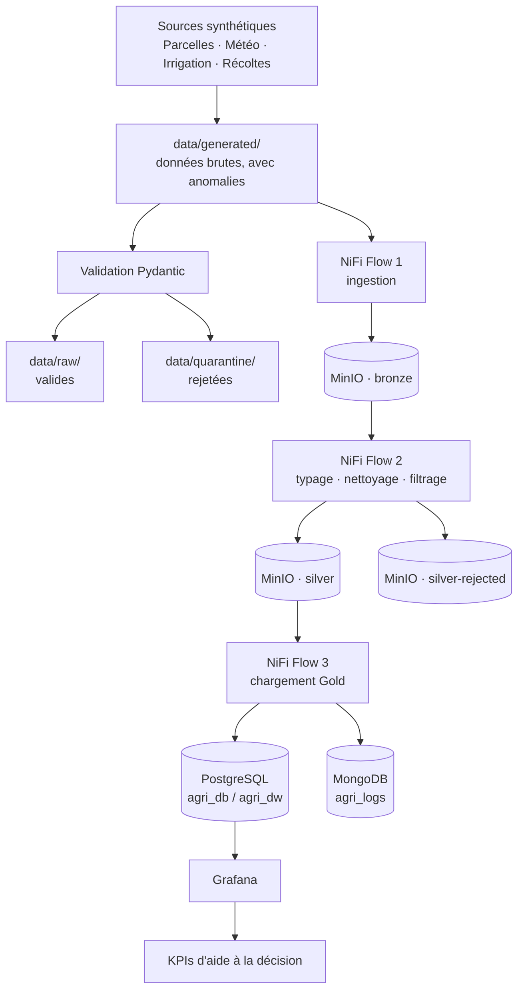

# Agri Data Platform


**Plateforme Data Engineering de bout en bout pour l'aide à la décision agricole**

*Projet Force-N — Certificat Data Engineering — Projet 5 : Agriculture maraîchère*

---

## 1. Vue d'ensemble

Agri Data Platform est une plateforme de données locale conçue pour intégrer des données agricoles hétérogènes et les transformer en jeux de données analytiques et en indicateurs d'aide à la décision.

Le projet simule l'environnement de données d'une exploitation maraîchère au Sénégal, où les données de parcelles, d'irrigation, de météo et de ventes/récoltes sont réparties sur plusieurs sources.

Le pipeline couvre l'ensemble de la chaîne :

`génération des données → validation qualité (Python) → ingestion brute (Bronze) → nettoyage et filtrage (Silver) → chargement analytique (Gold) → indexation temporelle → visualisation`

La plateforme fonctionne entièrement en local via Docker Compose.

## 2. Problématique métier

Les données opérationnelles agricoles sont souvent cloisonnées dans des fichiers CSV, des relevés manuels et des données de capteurs. Ce cloisonnement rend difficile :

- le suivi de l'efficience de l'irrigation ;
- la comparaison de la productivité des parcelles ;
- l'identification des pertes post-récolte ;
- la corrélation entre production et conditions environnementales.

La plateforme fournit un flux de données centralisé pour appuyer ces analyses.

**Utilisateurs cibles** : responsables d'exploitation, techniciens agricoles, conseillers de coopérative.

**Domaines de décision** : gestion de l'irrigation, analyse de production et de rendement, performance des parcelles, suivi des pertes post-récolte.

## 3. Architecture

Architecture medallion à trois zones (Bronze / Silver / Gold). Deux mécanismes de contrôle qualité, indépendants et complémentaires, coexistent :

- **Niveau génération (Python/Pydantic)** : valide la conformité structurelle des données générées, indépendamment du pipeline NiFi. Les enregistrements valides vont dans `data/raw/`, les invalides dans `data/quarantine/` avec le motif d'erreur.
- **Niveau pipeline (NiFi, Flow 2)** : applique son propre filtrage des anomalies métier lors du passage Bronze → Silver, sur les données brutes non filtrées (`data/generated/`). Les rejets sont tracés dans `silver-rejected/`.



| Couche | Technologie | Responsabilité |
|---|---|---|
| Génération des données | Python | Jeux de données de test réalistes, entièrement synthétiques |
| Validation source | Pydantic | Valider la conformité structurelle dès la génération, isoler les anomalies (`data/quarantine/`) |
| Intégration et qualité pipeline | Apache NiFi | Ingérer, typer, nettoyer, filtrer les anomalies métier, router, charger |
| Data Lake | MinIO | Stocker les jeux de données bruts (Bronze), nettoyés (Silver) et rejetés (Silver rejected) |
| Data Warehouse | PostgreSQL | Stocker les données analytiques structurées (Gold, schéma en étoile) |
| Données temporelles | MongoDB | Indexer les relevés météo et irrigation |
| Visualisation | Grafana | Exposer les indicateurs d'aide à la décision |
| Environnement d'exécution | Docker Compose | Environnement local reproductible |
| Gestion de versions | Git | Suivre les modifications et l'historique technique |

## 4. Flux de données

Quatre entités, générées localement, 100 % synthétiques (aucune source externe, conformément à la fiche projet) :

| Entité | Format Bronze | Colonnes principales |
|---|---|---|
| **Parcelles** | CSV | `parcel_id`, `zone`, `crop`, `surface_m2`, `planting_date`, `latitude`, `longitude`, `manager` |
| **Météo** | CSV | `zone`, `date`, `temperature_c`, `precipitation_mm`, `humidity_pct` |
| **Irrigation** | JSONL | `parcel_id`, `timestamp`, `water_volume_m3`, `soil_humidity_pct` |
| **Récoltes/Ventes** | CSV | `parcel_id`, `harvest_date`, `harvest_kg`, `sold_kg`, `unit_price_fcfa` |

## 5. Stratégie de qualité des données

**Niveau génération (Python/Pydantic)** : les enregistrements valides vont dans `data/raw/`, les invalides dans `data/quarantine/` avec le motif d'erreur (colonne `validation_error`, et numéro de ligne pour l'irrigation). Exemples de règles : `surface_m2 <= 0`, `sold_kg > harvest_kg`, `soil_humidity_pct > 100`.

**Niveau pipeline (NiFi, Flow 2)** : c'est ce flux, et non la validation Python, qui alimente le data lake. Chaque entité passe par un typage strict de schéma (Avro), un nettoyage des valeurs manquantes (ex. `manager` vide devient `Non renseigné`), puis un filtrage des anomalies métier via `QueryRecord`. Les enregistrements filtrés sont tracés dans `silver-rejected/` plutôt qu'écartés silencieusement.

**Résultat sur le jeu de rejeu** (`data/samples/unfiltered/`) : les deux contrôles rejettent exactement les mêmes lignes : 2 parcelles, 3 relevés météo, 2 récoltes et 4 relevés d'irrigation.

**Protection côté base** : une contrainte `CHECK` (migration 004) impose `soil_humidity_pct` entre 0 et 100 dans `fact_irrigation`.

## 6. Data Warehouse

PostgreSQL implémente un modèle dimensionnel en schéma en étoile, base `agri_db`, schéma `agri_dw`.

**Dimensions**
- `dim_zone` : référentiel fixe des 4 zones (Niayes, Vallée du Fleuve, Casamance, Sine-Saloum)
- `dim_date` : référentiel calendaire (2024–2030), chargé par la migration `002_seed_dim_date.sql`
- `dim_parcel` : les parcelles, avec clé de substitution technique `parcel_dim_id` (SERIAL) séparée de la clé métier source `parcel_id` (VARCHAR unique)

**Tables de faits** (référencent les dimensions via `parcel_dim_id`, `zone_id`, `date_id`)
- `fact_irrigation`
- `fact_weather`
- `fact_harvest`

Ordre de chargement (Flow 3) : `dim_zone` → `dim_date` → `dim_parcel` → tables de faits, avec lookup de `parcel_dim_id` / `zone_id` / `date_id` avant chaque insertion. Les seeds des dimensions `dim_zone` et `dim_date` sont idempotents (`ON CONFLICT`) ; `dim_date` est aussi remplie par la migration `002_seed_dim_date.sql`, ce qui rend le seed du flow 3 redondant mais sans effet.

Volumes chargés : `dim_zone` 4, `dim_date` 2557, `dim_parcel` 23, `fact_weather` 717, `fact_harvest` 21, `fact_irrigation` 6910.

Le modèle physique est documenté dans `sql/migrations/` (001 schéma, 002 `dim_date`, 003 vues KPI, 004 contrainte de plage).

## 7. Indicateurs d'aide à la décision (KPIs)

Les KPIs sont visualisés dans Grafana à partir de l'entrepôt PostgreSQL.

| KPI | Formule | Colonnes sources |
|---|---|---|
| Chiffre d'affaires global (FCFA) | `somme(sold_kg × unit_price_fcfa)` | `sold_kg`, `unit_price_fcfa` |
| Productivité de la parcelle (kg/m²) | `harvest_kg / surface_m2` | `harvest_kg`, `surface_m2` |
| Taux de perte post-récolte (%) | `(harvest_kg - sold_kg) / harvest_kg` | `harvest_kg`, `sold_kg` |
| Efficience de l'irrigation (kg/m³) | `harvest_kg / water_volume_m3` | `harvest_kg`, `water_volume_m3` |

Les trois derniers KPIs (productivité, taux de perte, efficience) sont exposés par des vues PostgreSQL (migration `003_create_kpi_views.sql`) ; le chiffre d'affaires est calculé directement dans la requête du panneau Grafana.

Le tableau de bord (`grafana/dashboards/agri-kpis-dashboard.json`) propose les filtres `zone` et `Culture`, ainsi que : productivité par culture, taux de pertes post-récolte, efficience de l'irrigation par culture, température contre volume d'irrigation, synthèse des parcelles et localisation des parcelles.

## 8. Choix technologiques

**Apache NiFi** : couche centrale d'intégration et d'orchestration (ingestion, typage, nettoyage, filtrage des anomalies, chargement), uniquement via des processeurs standards, sans ETL Python custom.

**MinIO** : stockage objet local S3-compatible pour les zones Bronze, Silver et Silver rejected.

**PostgreSQL** : entrepôt analytique relationnel, modélisation dimensionnelle en étoile.

**MongoDB** : retenu à la place de la stack ELK pour indexer les données temporelles (météo, irrigation) : stockage document flexible, complémentaire de PostgreSQL plutôt que substitutif. Base `agri_logs`, collections `weather_readings` et `irrigation_readings`. Détail dans `mongo/README.md`. Le détail des compromis ELK vs MongoDB est développé dans le rapport technique.

**Grafana** : visualisation des KPIs, datasource PostgreSQL provisionnée automatiquement.

**Docker Compose** : reproductibilité de l'environnement local (5 services : PostgreSQL, MinIO, MongoDB, NiFi, Grafana).

## 9. Structure du dépôt

```
agri-data-platform/
├── .github/
│   └── workflows/
├── data/
│   ├── generator/            # scripts de génération (4 entités)
│   ├── generated/            # zone de dépôt consommée par NiFi (vidée après lecture)
│   ├── raw/                  # données validées par Pydantic (jeu de référence du gold)
│   ├── quarantine/           # données rejetées par Pydantic, avec motif
│   └── samples/
│       └── unfiltered/       # données brutes avec anomalies (source du rejeu NiFi)
├── src/
│   └── validation/
├── nifi/
│   ├── flows/                # export JSON des 3 flows
│   └── drivers/              # driver JDBC PostgreSQL (monté dans NiFi)
├── sql/
│   └── migrations/           # 001 à 004
├── scripts/
│   └── init_db.sh            # charge les migrations dans PostgreSQL
├── grafana/
│   ├── dashboards/           # export JSON du tableau de bord
│   └── provisioning/         # datasource PostgreSQL
├── mongo/
│   ├── init_indexes.js
│   └── README.md
├── tests/
├── docker-compose.yml
├── .env.example
├── .gitattributes
├── requirements.txt
├── .gitignore
└── README.md
```

## 10. Reproductibilité

Le projet se reconstruit depuis zéro après un `docker compose down -v`. Certaines étapes restent manuelles dans NiFi, car NiFi n'exporte jamais les mots de passe.

### 10.1 Démarrer l'infrastructure

```bash
cp .env.example .env        # puis remplacer les valeurs factices (change_me)
docker compose up -d
bash scripts/init_db.sh     # charge les migrations SQL dans PostgreSQL (schéma agri_dw)
```

- MongoDB crée ses collections et ses index à la première initialisation (`mongo/init_indexes.js`).
- Grafana crée sa datasource PostgreSQL automatiquement (`grafana/provisioning/`).
- Le driver JDBC est versionné dans `nifi/drivers/` et monté dans NiFi (`/opt/nifi/nifi-current/jdbc-drivers/`).

Services exposés : PostgreSQL (5433), MinIO (9000/9001), MongoDB (27018), NiFi (8443), Grafana (3000, accessible uniquement depuis la machine locale).

### 10.2 Configurer NiFi (https://localhost:8443/nifi)

1. Créer le bucket `agriculture-raw` dans MinIO (http://localhost:9001).
2. Importer les 3 flows de `nifi/flows/` (Process Group, icône d'import).
3. Saisir les mots de passe, jamais exportés :
   - `DBCP-Postgres-Gold` : utilisateur et mot de passe de `.env`, driver `/opt/nifi/nifi-current/jdbc-drivers/postgresql-42.7.4.jar`
   - clés MinIO (`MINIO_ROOT_USER`, `MINIO_ROOT_PASSWORD`) dans les processeurs S3
   - `MongoDB-Connection` : mot de passe Mongo de `.env`
4. Activer les Controller Services.

### 10.3 Rejouer le pipeline

```bash
cp data/samples/unfiltered/* data/generated/    # GetFile supprime les fichiers après lecture
```

- `data/raw/` : données **validées** par Pydantic (jeu de référence, correspond au gold et au tableau de bord).
- `data/quarantine/` : données **rejetées** par Pydantic, avec le motif d'erreur.
- `data/samples/unfiltered/` : données **brutes** avec anomalies (valides plus rejetées), source du rejeu. Le Bronze reçoit ainsi la donnée brute et le flow 2 doit en rejeter 2 parcelles, 3 relevés météo, 2 récoltes et 4 relevés d'irrigation.

Lancer les flows dans l'ordre : flow 1 (Bronze), flow 2 (Silver et rejets), flow 3 (Gold). Ne pas démarrer `GetFile-Irrigation` et `PutS3-Irrigation-Bronze` du flow 2 : ils font doublon avec le flow 1. Ne pas relancer le flow 3 sur un entrepôt déjà chargé : il n'est pas idempotent.

Si la validation Pydantic doit être rejouée, la lancer **avant** NiFi : `GetFile` supprime les fichiers de `data/generated/` après lecture.

### 10.4 Grafana (http://localhost:3000)

Se connecter avec `GRAFANA_USER` et `GRAFANA_PASSWORD` de `.env`, puis importer `grafana/dashboards/agri-kpis-dashboard.json`. La datasource `Postgres-agri` existe déjà.

### 10.5 Vérification

| Cible | Attendu |
|---|---|
| PostgreSQL `agri_dw` | `dim_zone` 4, `dim_parcel` 23, `fact_weather` 717, `fact_irrigation` 6910, `fact_harvest` 21 |
| MongoDB `agri_logs` | `weather_readings` 717, `irrigation_readings` 6910 |
| MinIO `silver-rejected` | 2 parcelles, 3 relevés météo, 2 récoltes, 4 relevés d'irrigation |

## 11. Sources de données

Données 100 % générées et synthétiques, aucune source externe, conformément à la fiche projet.

## 12. Statut du projet

**Statut : infrastructure et pipeline terminés, livrables en cours**

- [x] Initialisation du dépôt et structure du projet
- [x] Génération des données (4 entités, Python)
- [x] Validation des données (Pydantic, quarantaine fonctionnelle)
- [x] Infrastructure Docker (5 services) et test de reconstruction complète (`down -v`)
- [x] Modèle dimensionnel PostgreSQL (6 tables, migrations 001 à 004)
- [x] Flow NiFi 1 : Bronze (4 entités)
- [x] Flow NiFi 2 : nettoyage, typage, filtrage, rejets `silver-rejected` (4 entités)
- [x] Flow NiFi 3 : chargement Gold PostgreSQL et MongoDB (4 entités)
- [x] Intégration MongoDB (indexation weather/irrigation, index documentés)
- [x] Tableau de bord Grafana (4 KPIs, datasource provisionnée)
- [x] Tests automatisés (pytest, 21 tests) et intégration continue (GitHub Actions)
- [ ] Rapport technique et présentation finale

## 13. Principes d'ingénierie

- **Reproductibilité** : environnement exécutable localement via Docker Compose, reconstruction complète testée.
- **Séparation des responsabilités** : génération, validation, intégration, stockage et visualisation restent distincts.
- **Qualité des données à deux niveaux** : contrôle source (Pydantic) et contrôle pipeline (NiFi), tous deux observables, jamais silencieux.
- **Gestion de versions** : développement incrémental, un commit = une phase testée.
- **Documentation** : décisions techniques et limites explicitement documentées.

## 14. Limites connues

- Données agricoles simulées : ne reproduit pas toute la complexité d'un système d'information agricole réel.
- Les KPIs sont des indicateurs d'aide à la décision, pas des recommandations agronomiques autonomes.
- Les mots de passe NiFi (PostgreSQL, MinIO, MongoDB) se ressaisissent à la main après un `down -v`, car NiFi ne les exporte pas.
- `.env.example` ne contient que des valeurs factices à changer hors machine locale.
- Les seeds de dimensions (`dim_zone`, `dim_date`) sont idempotents, mais le chargement des tables de faits ne l'est pas : relancer le flow 3 sans `TRUNCATE` préalable des tables de faits ajoute des doublons.
- Les coordonnées GPS des parcelles sont simulées et ne correspondent pas toujours à la zone indiquée : les parcelles de Casamance ont une latitude moyenne d'environ 15,7 °N alors que la Casamance se situe vers 12,5 à 13 °N. La carte du tableau de bord illustre la répartition par zone, pas des positions réelles.
- Les générateurs météo et irrigation n'ont pas de graine fixe : `data/raw/` est le jeu de référence versionné, et le régénérer change les valeurs.
- Les identifiants de parcelles (`parcel_id`) sont générés avec `uuid4()`, non reproductibles d'une génération à l'autre : régénérer les données exige de recharger toute la chaîne Parcel avant les autres entités.
- Filtrage des anomalies basé sur des règles de plage simples (`surface_m2`, `temperature_c`, `soil_humidity_pct`, `sold_kg`).
- Les rejets de `silver-rejected/` contiennent les colonnes d'origine sans le motif de rejet (la quarantaine Pydantic, elle, garde `validation_error`). Les deux contrôles rejettent les mêmes lignes sur ce jeu de données.
- Le rejet d'irrigation écrit par NiFi est un tableau JSON sur une seule ligne, et non du JSONL comme la source.
- Le flow 2 contient une chaîne d'irrigation redondante avec le flow 1 (à ne pas démarrer), et le seed de `dim_date` du flow 3 fait doublon avec la migration 002 (sans effet, grâce à `ON CONFLICT`).
- L'image `minio/minio` n'est pas figée (`latest`).
- Le tableau de bord n'est pas provisionné : il s'importe à la main.

## 15. Perspectives d'amélioration

- Réutilisation des scripts SQL dans un futur orchestrateur (Airflow, Spark).
- Chargement Gold idempotent (UPSERT) pour permettre de relancer un flow sans doublons.
- Graine fixe pour les générateurs et les `parcel_id`, pour des jeux de données reproductibles.
- Motif de rejet dans `silver-rejected/` (colonne `rejection_reason`).
- Unification des deux mécanismes de contrôle qualité (Pydantic et NiFi).
- Provisionnement automatique du tableau de bord Grafana et image MinIO figée.

## 16. Contexte du projet

Ce projet est développé dans le cadre de la certification Data Engineering Force-N. Il vise à démontrer un workflow Data Engineering de bout en bout, de l'ingestion de données hétérogènes jusqu'au stockage analytique et à la visualisation orientée décision.

## 17. Auteur

Aliou THIELO — [github.com/Aliou-THIELO](https://github.com/Aliou-THIELO)
